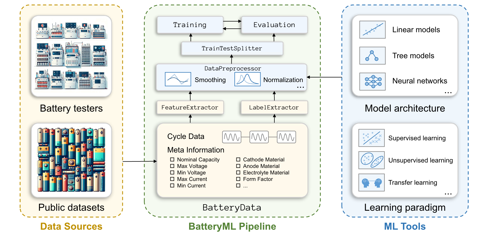

<div align="center">  
   
</div>  

# BatteryML：用于电池性能衰退机器学习的开源工具

## 最新动态

这是 BatteryML 的官方代码和数据仓库。BatteryML 是一个用于电池性能衰退机器学习的开源工具，相关论文发表于 ICLR 2024。欢迎为 BatteryML 点 Star、Watch 和 Fork，以获取项目的最新进展。我们也欢迎大家提出问题和建议！

论文现已发布于 [Arxiv](https://arxiv.org/abs/2310.14714) 和 [ICLR 2024](https://iclr.cc/virtual/2024/poster/17628)。论文对 BatteryML 的设计进行了详细介绍，项目也会在持续开发过程中不断更新。

## 项目介绍

锂电池的性能衰退是一个复杂的电化学过程，涉及固体电解质界面膜生长、锂析出、活性物质损失等因素。此外，这种不可避免的性能衰退会显著影响一些关键商业场景，例如导致电动汽车用户产生“里程焦虑”，以及影响储能系统的供电稳定性。因此，如何有效分析和预测锂电池的性能衰退，从而为提前预防和干预提供依据，已经成为一个重要的研究课题。

为此，我们开源了 BatteryML 工具，以促进电池性能衰退方向的机器学习研究与开发。我们希望 BatteryML 能够帮助电池研究人员和数据科学家从电池衰退数据中获得更深入的认识，并构建更强大的模型，实现更加准确的预测和更加及时的干预。

## 框架



## 项目特点

- **开源和社区驱动：** BatteryML 是一个开源的电池衰退建模项目，鼓励计算机科学和电池研究两个领域的社区参与贡献与合作，共同推动这一重要领域的发展。
- **全面的数据集集合：** BatteryML 包含多个完整的数据集，方便用户访问目前公开的大多数电池数据。
- **数据预处理和特征工程：** 工具内置数据预处理和特征工程功能，帮助研究人员和开发者更加方便地准备可直接用于机器学习的电池数据集。
- **丰富的模型：** BatteryML 已经包含文献中的大多数经典模型，开发者可以快速比较和评估不同方法。
- **可扩展和可定制：** BatteryML 提供灵活的接口，支持进一步扩展和定制，因此能够适用于不同的电池研究场景。

## 数据集

| 数据来源 | 电极材料体系 | 标称容量 | 电压范围（V） | RUL 分布 | SOC 分布（%） | SOH 分布（%） | 电芯数量 |
|---|---|---:|---|---|---|---|---:|
| CALCE | LCO/石墨 | 1.1 | 2.7-4.2 | 566±106 | 77±17 | 48±30 | 13 |
| MATR | LFP/石墨 | 1.1 | 2.0-3.6 | 823±368 | 93±7 | 36±36 | 180 |
| HUST | LFP/石墨 | 1.1 | 2.0-3.6 | 1899±389 | 100±10 | 43±28 | 77 |
| HNEI | NMC_LCO/石墨 | 2.8 | 3.0-4.3 | 248±15 | 64±17 | 49±28 | 14 |
| RWTH | NMC/碳 | 1.11 | 3.5-3.9 | 658±64 | 60±24 | 46±22 | 48 |
| SNL | NCA、NMC、LFP/石墨 | 1.1 | 2.0-3.6 | 1256±1321 | 86±7 | 45±27 | 61 |
| UL_PUR | NCA/石墨 | 3.4 | 2.7-4.2 | 209±50 | 89±6 | 41±33 | 10 |

针对 RUL（剩余使用寿命）预测任务，我们还将多个公开数据源组合起来，构建了混合数据集，用于评估不同电池数据联合训练时的效果。

- CRUH 合并了 CALCE、RWTH、UL_PUR 和 HNEI 数据集；
- CRUSH 合并了 CALCE、RWTH、UL_PUR、SNL 和 HNEI 数据集；
- MIX 包含本研究使用的全部数据集。

更详细的数据集信息请参考论文附录 A。

## RUL 任务的基准测试结果

以下是剩余使用寿命预测任务的基准测试结果。对比方法分为四类：

1. **虚拟回归器：** 使用训练集标签均值作为预测结果的简单基线；
2. **线性模型：** 使用领域专家设计的特征；
3. **传统统计模型：** 使用 `QdLinear` 特征；
4. **深度学习模型：** 使用 `QdLinear` 特征。

对于对初始化敏感的模型，表中给出 10 个随机种子下的平均误差，并将标准差作为下标附在结果旁边。

| **模型** | **MATR1** | **MATR2** | **HUST** | **SNL** | **CLO** | **CRUH** | **CRUSH** | **MIX** |
|---|---:|---:|---:|---:|---:|---:|---:|---:|
| 虚拟回归器 | 398 | 510 | 419 | 466 | 331 | 239 | 576 | 573 |
| 方差模型 | 136 | 211 | 398 | 360 | 179 | 118 | 506 | 521 |
| 放电模型 | 329 | **149** | **322** | 267 | 143 | 76 | >1000 | >1000 |
| 完整模型 | 167 | >1000 | 335 | 433 | **138** | 93 | >1000 | 331 |
| 岭回归 | 116 | 184 | >1000 | 242 | 169 | 65 | >1000 | 372 |
| PCR | **90** | 187 | 435 | **200** | 197 | 68 | 560 | 376 |
| PLSR | 104 | 181 | 431 | 242 | 176 | **60** | 535 | 383 |
| 高斯过程 | 154 | 224 | >1000 | 251 | 204 | 115 | >1000 | 573 |
| XGBoost | 334 | 799 | 395 | 547 | 215 | 119 | **330** | 205 |
| 随机森林 | 168±9 | 233±7 | 368±7 | 532±25 | 192±2 | 81±1 | 416±5 | **197±0** |
| MLP | 149±3 | 275±27 | 459±9 | 370±81 | 146±5 | 103±4 | 565±9 | 451±42 |
| CNN | 102±94 | 228±104 | 465±75 | 924±267 | >1000 | 174±92 | 545±11 | 272±101 |
| LSTM | 119±11 | 219±33 | 443±29 | 539±40 | 222±12 | 105±10 | 519±39 | 268±9 |
| Transformer | 135±13 | 364±25 | 391±11 | 424±23 | 187±14 | 81±8 | 550±21 | 271±16 |

## 快速开始

### 安装

```shell
pip install -r requirements.txt
pip install .
```

上述命令会将 BatteryML 安装到当前 Python 环境中，同时安装便捷的命令行工具 `batteryml`。如果需要使用深度学习模型，还可能需要额外安装 [PyTorch](https://pytorch.org/get-started/locally/)。

### 下载原始数据并运行预处理脚本

现在，只需要两条命令，就可以下载公开数据集并将其预处理为 BatteryML 的 `BatteryData` 格式：

```bash
batteryml download MATR /path/to/save/raw/data
batteryml preprocess MATR /path/to/save/raw/data /path/to/save/processed/data
```

### 使用测试设备数据运行预处理脚本

如果你的数据是通过 ARBIN、NEWARE 等电池测试设备采集的，可以使用以下命令，将其处理为 BatteryML 的 `BatteryData` 格式：

```bash
batteryml preprocess ARBIN /path/to/save/raw/data /path/to/save/processed/data --config /path/to/config/yaml/file
```

由于不同软件版本和配置之间存在差异，即使是同一种测试设备导出的数据，其格式和字段也可能不同。因此，项目在 `/configs/cycler` 目录下提供了默认处理配置，用于将原始数据字段映射到目标数据字段。你可以根据需要修改这些默认配置。

目前项目支持 ARBIN 和 NEWARE 数据格式。此外，Biologic、LANDT 和 Indigo 格式也正在集成中。如果在使用测试设备数据处理功能时遇到问题，可以提交 issue，并附上示例数据文件，以帮助项目快速增加兼容性。

### 使用配置文件运行训练和推理任务

BatteryML 支持通过简单的配置文件指定训练和推理流程。项目在 `configs` 目录中提供了多个示例。

例如，下面的命令可以复现用于电池寿命预测的 `variance` 模型：

```bash
batteryml run configs/baselines/sklearn/variance_model/matr_1.yaml --workspace ./workspace/test --train --eval
```

## 引用

如果你觉得该项目对你的研究有帮助，欢迎引用以下论文：

```bibtex
@inproceedings{zhang2024batteryml,
  title={Battery{ML}: An Open-source Platform for Machine Learning on Battery Degradation},
  author={Han Zhang and Xiaofan Gui and Shun Zheng and Ziheng Lu and Yuqi Li and Jiang Bian},
  booktitle={The Twelfth International Conference on Learning Representations},
  year={2024}
}
```

## 文档说明

借助 BatteryML，研究人员可以深入了解电池预测和材料科学领域的最新进展，更高效地开展实验。

我们欢迎大家加入 BatteryML，共同加速电池研究与创新。
